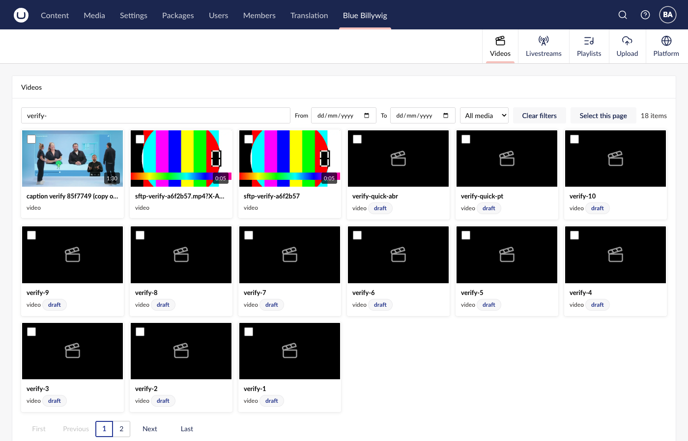
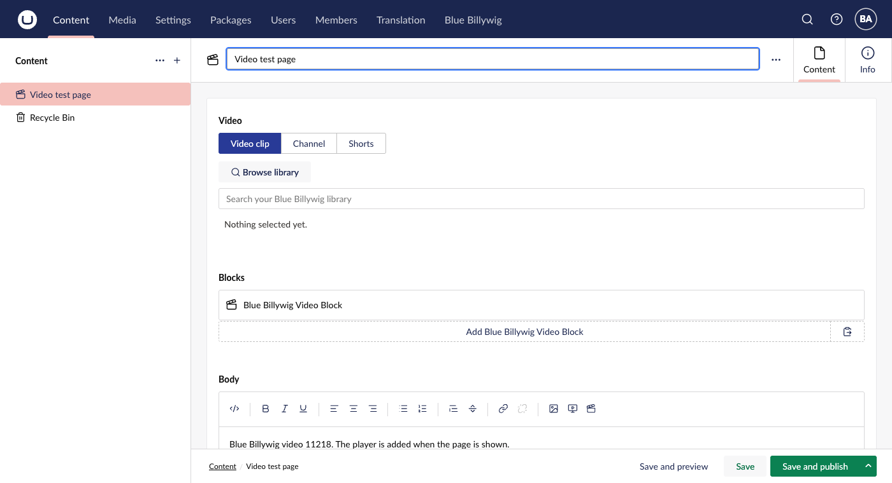

# Blue Billywig for Umbraco

Blue Billywig Online Video Platform (OVP) for Umbraco 17. Editors pick a video from their Blue Billywig publication in the backoffice, and the site renders the player on the frontend. It is the Umbraco counterpart of the reference plugin.

## Status

Early. Version 0.1.0, **not released**, not on NuGet; the repository is private and the licence is not chosen. The package has been built against the development publication only, and a part of it is proven there, a part is built but not fully proven, and a few rows could not be proven in the test environment. [docs/PARITY.md](docs/PARITY.md) is the source of truth: one row per reference plugin feature, each marked Open, Partial, Proven or Blocked, with the evidence. Read it before you promise anything to a customer.

What is built:

- A **Blue Billywig section** in the backoffice: video library (list, search, filters, folders, playlists, livestreams, details, copy embed code), direct browser-to-storage **upload** (Uppy 5.x), clip **editing** (metadata, tags, status, content protection policy, playout, language, embargo, subtitles, thumbnails, bulk actions), delete behind a stricter permission.
- A **call to action** editor with an email form overlay, **analytics** (dashboard and a per-video retention curve), and a **settings dashboard** with connection, defaults, content protection and a cleanup action.
- A **Blue Billywig Video** property editor (clip, channel or shorts), a rich text toolbar button and oEmbed for pasted links.
- Server-rendered embeds through one render path: JavaScript or iframe embed code, lazy loading, transcript, chapters, consent placeholder, CSP nonce, **content gate** for members and member groups, JSON-LD and a **video sitemap**.
- **Translations** for the backoffice and for the texts visitors see, in English plus da, de, fi, fr, nb, nl and sv ([docs/TRANSLATIONS.md](docs/TRANSLATIONS.md) says what is covered and what still needs a native review).
- Razor helpers (view component, `<bb-video>` tag helper, block partials), a Delivery API output, a replaceable SAPI client (`IBlueBillywigClient`) and options for the loader and lazy loading.



*The video library in the Blue Billywig section.*



*The Blue Billywig Video property editor on a page.*

Playback of protected clips, the read-only preview token and some player behaviour could not be shown in the test environment; PARITY.md says which. Differences from the reference plugin that the owner accepted on purpose are listed under [Accepted deviations](docs/PARITY.md#accepted-deviations).

## Quick start

You need the prerequisites in [docs/BUILD.md](docs/BUILD.md): .NET SDK 10, Node 24 and npm 11, git.

```bash
git clone https://github.com/bluebillywig/umbraco-plugin.git
cd umbraco-plugin
./build.sh pack     # client bundle and Vitest, .NET build, xUnit tests, then artifacts/BlueBillywig.Umbraco.<version>.nupkg
```

Use `./build.sh` without `pack` to build and test only.

To run the test site and use the package, follow [docs/DEVELOPMENT.md](docs/DEVELOPMENT.md).

## Documentation

| Document | For | Contents |
|---|---|---|
| [docs/INSTALL.md](docs/INSTALL.md) | Site owners | Install, every option, user groups, content protection, sitemap, CSP, extension points, troubleshooting |
| [docs/USER-GUIDE.md](docs/USER-GUIDE.md) | Editors | Pick, upload, browse, edit, call to action, analytics, known limits |
| [docs/BUILD.md](docs/BUILD.md) | Anyone building | Prerequisites, `build.sh`, each step by hand, troubleshooting |
| [docs/DEVELOPMENT.md](docs/DEVELOPMENT.md) | Developers | Local site, credentials, watch mode, conventions, adding an endpoint, element or test, the authorization sweep |
| [docs/ARCHITECTURE.md](docs/ARCHITECTURE.md) | Developers | How the package is built today, with file paths |
| [docs/RELEASING.md](docs/RELEASING.md) | Release managers | Versioning, pack, NuGet Trusted Publishing, checklist |
| [docs/PARITY.md](docs/PARITY.md) | Everyone | Feature parity with the reference plugin, and the [accepted deviations](docs/PARITY.md#accepted-deviations) |
| [docs/TRANSLATIONS.md](docs/TRANSLATIONS.md) | Translators, developers | Locales, how strings are added, which translations need a native review |
| [docs/LICENSES.md](docs/LICENSES.md) | Release managers | Licence scan of dependencies |
| [THIRD-PARTY-NOTICES.md](THIRD-PARTY-NOTICES.md) | Distributors | Notices for third-party code the package ships |
| [CLAUDE.md](CLAUDE.md) | Coding sessions | Commands, architecture, rules |

## Requirements

- Umbraco CMS 17 (developed against 17.8.0; the package declares 17.8.0 up to, not including, 18) on .NET 10.
- A Blue Billywig publication and an API token (ID and secret) with SAPI access.
- To build from source: .NET SDK 10, Node.js with npm (see [docs/BUILD.md](docs/BUILD.md) for versions).

## Licence

Not chosen yet. The repository has no `LICENSE` file, and the package must not be published until one is added. The reference plugin declares GPLv2 or later, and the package ports logic from it, so the choice needs confirmation from whoever owns that code. See [docs/LICENSES.md](docs/LICENSES.md).
