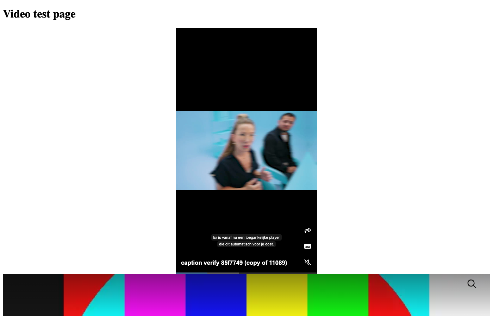
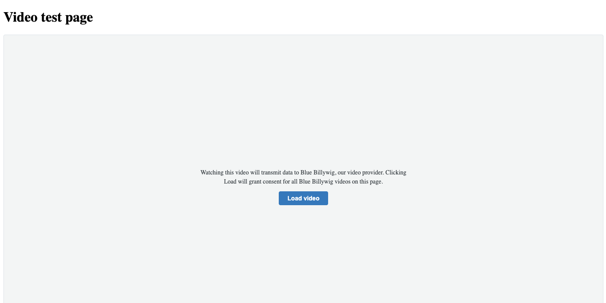

# Installing Blue Billywig in an Umbraco site

For the person who owns the Umbraco site. Editors: see [USER-GUIDE.md](USER-GUIDE.md). This describes version `1.0.0-rc.1`, a **pre-release** on nuget.org (install with `--prerelease`; licence MIT). The local package file route below is for testing a build of your own. What works and what is proven is in [PARITY.md](PARITY.md); read it before you promise anything to a customer. Steps marked "not verified" were read from the code and not run on a separate site. The test site in this repository (`src/UmbracoSite`) is the only site the package has been run in.

## Requirements

- Umbraco CMS 17 on .NET 10. The package was built and tested against Umbraco 17.8.0. Its four `Umbraco.Cms.*` dependencies are declared as `[17.8.0, 18.0.0)`: 17.8.0 or higher, below 18. A site on Umbraco 17.0 to 17.7 cannot install it.
- A Blue Billywig publication and an API token (ID and secret) with SAPI access. Ask Blue Billywig for one. A second, **read-only** token (Analyst role) is optional: it is used only to preview draft clips in the backoffice.
- Outbound HTTPS from the server to `https://{publication}.bbvms.com` (or your configured base URL).
- For upload: the browser sends the file parts straight to Blue Billywig's storage, so the storage must allow your backoffice origin (CORS). That is set on the platform side.

## Install

Once the pre-release is on nuget.org (it is not yet), install it with `--prerelease` or the exact version:

```bash
dotnet add package BlueBillywig.Umbraco --version 1.0.0-rc.1
# or: dotnet add package BlueBillywig.Umbraco --prerelease
```

From a local folder (for testing before publication): build it ([BUILD.md](BUILD.md)) or get the `.nupkg` from Blue Billywig, put it in a folder, and add that folder as a source:

```bash
dotnet add package BlueBillywig.Umbraco --version 1.0.0-rc.1 --source /path/to/folder-with-nupkg
```

Either way this pulls in `BlueBillywig.Sapi` and `Swashbuckle.AspNetCore`. Your site's own Umbraco packages must satisfy the range above.

There is nothing to register in `Program.cs` beyond what Umbraco needs. The package uses `IComposer` classes, which `AddComposers()` finds. Its backoffice files are served from `/App_Plugins/BlueBillywig/` as Static Web Assets. Restart the site after adding the package. Not verified on a separate site.

### Give user groups the section (an install step)

The package adds a **Blue Billywig** section to the backoffice (Videos, Livestreams, Playlists, Upload and Platform tabs). A section is shown per user group, and nobody has it after installing:

1. **Users > User Groups**, open a group (Administrators included).
2. Under **Sections**, tick **Blue Billywig**. Save.
3. If the section does not show, the users sign out and in again (not verified).

The server checks the same rule: every library, edit, upload and CTA endpoint answers 403 for a user whose groups do not allow the section. Not verified on a fresh site; the check is `SectionAccessRequirement` in `Authorization/BlueBillywigPolicies.cs`.

## Configure

Easiest: sign in to the backoffice, open **Settings**, choose the **Blue Billywig** dashboard, fill in publication, API ID and API secret, **Save**, then **Test connection**. Secrets are stored encrypted with ASP.NET Data Protection. If your Data Protection keys change (a new server without shared keys, a reset key ring), the stored secrets can't be read and you have to enter them again, and, if content protection is on, every viewer pseudonym in the tokens changes (see below).

For production, put credentials in configuration so they are not in the database. Section `BlueBillywig`, names exactly as in `BlueBillywigOptions`:

```json
{
  "BlueBillywig": {
    "Publication": "my-publication",
    "BaseUrl": "",
    "ApiId": "",
    "ApiSecret": "",
    "ReadOnlyApiId": "",
    "ReadOnlyApiSecret": "",
    "GateSharedSecret": "",
    "DeleteUserGroups": ["admin", "editor"],
    "DisableLazyLoader": false,
    "ForceLazyLoader": false,
    "LazyLoadOEmbed": true,
    "LazyLoadOEmbedChannel": false,
    "LazyLoadComponent": true
  }
}
```

| Name | Meaning |
|---|---|
| `Publication` | Publication name, the `X` in `X.bbvms.com` |
| `BaseUrl` | SAPI and player origin, https only. Leave out for `https://{Publication}.bbvms.com`. Set it only for a publication on another host |
| `ApiId`, `ApiSecret` | Read-write token. The ID is numeric |
| `ReadOnlyApiId`, `ReadOnlyApiSecret` | Read-only token, used only for the preview of clips in the library. It must be a different key from the read-write one (the settings refuse the same ID). The token is part of the preview address that the browser sees |
| `GateSharedSecret` | The shared secret of the content protection policy. Wins over a value saved in the dashboard |
| `DeleteUserGroups` | Aliases of the user groups that may delete clips, on top of access to the section. Default `admin` and `editor` |
| `DisableLazyLoader` | Switches off `bb-lazy.css` and `bb-lazy.js` completely (default false). The loader also carries the consent placeholder's Load button and the chapter links' click handler, so a site that disables it takes those over |
| `ForceLazyLoader` | Makes `<bb-assets />` emit the lazy loader even when nothing on the page asked for it yet (default false). Embeds always ship the loader themselves; this is for markup that a script adds later |
| `LazyLoadOEmbed` | Whether a pasted clip URL in rich text is lazy loaded (default true) |
| `LazyLoadOEmbedChannel` | Same for a pasted channel URL (default false) |
| `ShowEmbedProblems` | Shows the visible embed problem marker (class `bb-embed-problem`) to every visitor instead of only to signed-in backoffice users (default false). For staging or debugging; leave it off in production. See ARCHITECTURE.md, "Embed problem marker" |
| `LazyLoadComponent` | Whether a clip rendered by id from Razor (`<bb-video video-id=...>` or the view component) is lazy loaded when the call does not say (default true). A stored property value keeps its own choice |

Use environment variables or your secret store for the secrets, for example `BlueBillywig__ApiSecret` and `BlueBillywig__DeleteUserGroups__0`. A value set in configuration wins over one saved in the dashboard; the dashboard then shows that field as read-only. The other settings below (playout, embed type, page size, toggles, content protection options) are saved from the dashboard only.

## Settings dashboard

**Settings > Blue Billywig.**

Boxes:

- **Blue Billywig connection**: publication, API ID, API secret, read-only ID and secret. Secrets are write-only: after saving, the field says one is stored; leave it empty to keep it. The **API base URL** is shown but never editable: every API call sends the read-write token to it, so it can only be set in configuration (`BlueBillywig:BaseUrl`, on a Blue Billywig domain). A save tests the credentials against Blue Billywig and is refused when they fail.
- **Defaults**: **Default playout** (a dropdown filled from your publication; a saved value that is not in the list stays selectable; the order of precedence on the page is the embed's own playout, then the playout chosen for that clip in the library, then this default), **Default embed type** (`javascript`, `iframe`, `oembed`, `url` or `amp`; only the embed code of the chosen type is requested), **Videos per page** (1 to 200; the library uses it up to 200, the picker is capped at 15), a **Consent message** (the text above the **Load video** button; empty uses the built-in text, up to 500 characters) and two toggles: **Custom fields** (shows your publication's custom field groups in the clip editor) and **Call to action editor** (on by default; off hides the CTA editor, makes every CTA endpoint answer 404 and stops the form overlay assets from being emitted).
- Buttons **Save**, **Test connection** (tests the values typed in the form), **Disconnect** (removes the stored credentials, after a confirmation) and **Clear cache**. Saving clears the package's cache and says so ("Settings saved. Cache cleared.").
- **Content protection**: see below.
- **Remove stored settings**: the cleanup action, see below.

A banner on the library views says "the package is installed but not configured yet" with a link here when credentials are missing.

## User groups and policies

| Who | Can |
|---|---|
| Group with access to the **Settings** section | Open the settings dashboard, content protection settings, cleanup |
| Group with access to the **Content** section | Use the Blue Billywig Video property editor (search the library, pick), see the analytics dashboard on the Content section's dashboard page |
| Group with access to the **Blue Billywig** section | Browse the library, preview, copy embed code, **upload**, **edit** (metadata, tags, status, content protection policy, playout, language, embargo, folder, custom fields, subtitles incl. upload, thumbnails), bulk status/folder/policy (changing the content protection policy of a clip, singly or in bulk, additionally needs a user group that may delete: `DeleteUserGroups`), call to action, per-clip analytics |
| Group with the section **and** a group alias in `DeleteUserGroups` (default `admin`, `editor`) | **Delete** clips (single and bulk) and delete subtitles |

This follows the reference plugin's split: authors change metadata, editors and up do destructive things. Removing a call to action is *not* a delete here (it needs only the section), as in the reference plugin. A user with the section but outside the delete groups sees no Delete buttons, and the server refuses with 403 anyway. The rich text toolbar button and the property editor's **Browse library** open the library picker; whether a user without the Blue Billywig section can use it was not verified (the picker lists clips through endpoints under the Content policy; some library facts in it use the section policy).

## Using the property editor

1. **Settings > Data Types > Create > Data Type.** Choose the property editor **Blue Billywig Video** (group "media") and save.
2. Add a property with that data type to a Document Type, or to an element type used as a block.
3. For a Block List or Block Grid: create an element type with the alias `blueBillywigVideo` and put the property on it. The package ships partials that render such blocks without further setup. For another alias, add a one-line partial under `Views/Partials/blocklist/Components/` (or `blockgrid`, `richtext`) containing `@await Html.PartialAsync("BlueBillywig/Block", Model.Content)`. For rich text blocks, copy the package's `richtext/Components/blueBillywigVideo.cshtml`, which leaves a reference that the package turns into the player per request.

On the page the property renders the player:



*A page on the demo site with player blocks rendered.*

## Razor

In `Views/_ViewImports.cshtml` of your site, enable the tag helpers:

```cshtml
@addTagHelper *, BlueBillywig.Umbraco
```

Then, in a template for a document with a property `video`:

```cshtml
@{
    var video = Model.Value<BlueBillywig.Umbraco.Embedding.BlueBillywigVideo>("video");
}
<bb-video video="video" />
```

This is the form used by the test site's template, `src/UmbracoSite/Views/videoPage.cshtml`.

By id, without a property: `<bb-video type="clip" video-id="123" playout="default" lazy="false" />`. Attributes: `video`, `type` (`clip`, `channel`, `shorts`), `video-id`, `playout`, `lazy`, `transcript`, `chapters`. When `video` is given, only `lazy` and `playout` override it; `transcript` and `chapters` apply to `video-id` use.

View component:

```cshtml
@await Component.InvokeAsync("BlueBillywigVideo", new { video = Model.Value<BlueBillywig.Umbraco.Embedding.BlueBillywigVideo>("video") })
```

Partial: `@await Html.PartialAsync("BlueBillywig/Video", Model.Value<BlueBillywig.Umbraco.Embedding.BlueBillywigVideo>("video"))`.

All of them go through the same renderer, which emits the package's CSS and script once per page. Do not add `bb-lazy.js` yourself. A null or invalid value renders nothing. If a theme needs the loader before any embed (for markup that a script adds later), put `<bb-assets />` in the layout's head and set `ForceLazyLoader`.

## Rich text

In a rich text editor, the **Embed** button accepts pasted `https://{publication}.bbvms.com/p/{playout}/c/{id}.html`, `/view/{playout}/{id}.html` and `/ch/{id}.html` URLs. The editor stores a **reference** (inert text that names no player host). The player is made when the page is rendered, per request, so consent, the CSP nonce and content protection apply to rich text embeds as they do to the property. The template must output the rich text through Umbraco's normal property rendering (`@Model.Value("body")`); the package wraps Umbraco's rich text converter for this.

**Toolbar button.** To give editors a "Blue Billywig video" button that opens the library: **Settings > Data Types > your Rich Text Editor data type**, enable the **Embed** extension, add **Blue Billywig video** to the toolbar, **Save**. (In the development test the button was added by setting the toolbar value and saving, because drag and drop failed; this is recorded in PARITY.md row E4.)

## Content protection (members and member groups)

Clips and channels can carry a content protection policy (CPP) in Blue Billywig. The package gives members of chosen member groups a signed token and shows everybody else a gate message.

**Playback of protected clips could not be shown end to end** (PARITY G1, Blocked): the token is valid HS256 with the right claims, but the platform in the test environment refused it like a wrong-secret token, so what happens on a real publication is not proven. Test it on your publication before relying on it.

Setup:

1. In Blue Billywig, create a content protection policy with a **Shared Secret** rule and note its secret.
2. In **Members**, create member groups and members. Members must be approved and not locked out. The package does not ship a login form: your site signs members in with Umbraco's member sign-in. **A backoffice login is not a member**; to watch protected videos an editor signs in as a member.
3. **Settings > Blue Billywig > Content protection**:
   - **Enable content protection**. When off, nothing is gated.
   - **Shared secret**: paste the policy's secret (write-only; a "Remove secret" button clears it). Or set `BlueBillywig:GateSharedSecret` in configuration; the field then shows as pinned. Length 32 to 512 characters, no spaces (a secret saved earlier with 16 to 31 characters keeps working; a secret set in configuration must meet the 32 characters or the gate stays closed with `secret_missing` and the log says why).
   - **Token lifetime (seconds)**: 300 to 7200 (default 3600). Values outside are clamped.
   - **Member groups with access**: tick the groups that may watch. **With none ticked nobody can**; there is no "every logged-in member" default.
   - **Login URL**: where the gate message sends visitors who are not signed in, for example `/login?returnUrl={returnUrl}` (`{returnUrl}` is replaced by the current page). A relative path starting with `/` or an http(s) URL.
   - **Gate message**: plain text shown instead of the video. Empty uses the default message. A visitor who is not signed in gets the login link under a custom message too, when a valid Login URL is set.
   - The box lists the publication's policies for reference.
4. In the library, open a clip, choose its **Content protection policy** in the editor and save (or use the bulk action).

Behaviour to know:

- The gate runs inside the one render path, so property, blocks, rich text, tag helper and view component are all covered. The transcript, chapters and JSON-LD of a protected clip are replaced with the player or the gate message. Shorts are not gated.
- It **fails closed**: if SAPI is down, the clip is missing, the shared secret is missing or anything else cannot be checked, the visitor sees the gate message. The dashboard (and the library views) then show a red banner with the counts per reason from the last hour.
- A response that carries a token or a gate message is sent with `Cache-Control: private, no-store` and kept out of ASP.NET output caching. If your CDN or a page cache ignores that, a token can be served to other visitors. In the dev environment a CDN cached the clip script's redirect for 90 seconds without looking at the query string, so one visitor's token reached an anonymous request (PARITY G6). Make sure your CDN varies on the `jwt` query parameter.
- The token's `sub` is an HMAC of the member's key with a per-install salt and pepper kept in the key-value table, never the member id. If the Data Protection keys change, the salt is regenerated and every `sub` changes.
- A clip with a policy is left out of the video sitemap.
- Replace the member logic by registering your own `IGateViewerProvider` (below).

## Video sitemap and JSON-LD

**Sitemap.** The package serves `/video-sitemap.xml` (anonymous, `application/xml`, cached by clients for 10 minutes). It lists the published pages that embed a clip (through the property, blocks or rich text), with the clip's title, description, thumbnail, player URL, duration and upload date. Left out: pages without a template or URL, pages behind Public Access, clips that are not published or have a content protection policy, clips of another publication. If SAPI cannot be asked the route answers **503 with `Retry-After: 300`** instead of an empty sitemap. At most 2000 clips; the result is cached 10 minutes for up to 8 host names.

**Which hosts get a sitemap.** The route is anonymous and its answer names absolute URLs, so the request's `Host` header is only compared with what the site has configured, never copied into a URL. The site's own hosts are, in this order: the domains assigned to content in Umbraco (**Settings > Culture and Hostnames**), `Umbraco:CMS:WebRouting:UmbracoApplicationUrl`, and the plain (wildcard-free) entries of `AllowedHosts`. A request for any other host gets a plain **404** (`Cache-Control: no-store`), and a site with none of the three configured has no sitemap until it sets one. The URLs in the file use the configured origin, with the request's scheme only where the entry names none.

Umbraco has no built-in sitemap to extend, so this is a separate file. Make crawlers find it:

- Add a line to your `robots.txt`: `Sitemap: https://www.example.com/video-sitemap.xml`
- Submit `https://www.example.com/video-sitemap.xml` under **Sitemaps** in Google Search Console.

**JSON-LD.** For the embed types `iframe`, `oembed`, `url` and `amp` the package writes a `VideoObject` JSON-LD block next to the player (name, description, thumbnail, upload date, duration, transcript), escaped so a hostile title cannot break out of the script. For the `javascript` embed type the player brings its own, so the package adds none. The transcript field of the JSON-LD is covered by unit tests only (PARITY Q1).

## Content Security Policy and nonce

If your site sends a CSP, allow the player host. A script from `https://{publication}.bbvms.com` (or the host of your `BaseUrl`) is loaded, and the player may load frames, images, media and connections from Blue Billywig hosts. The exact directives and hosts the player needs were not determined here. Test with your policy in report-only mode first.

The package's own scripts (`bb-lazy.js`, `bb-cta-form-overlay.js`), the script tags in the embed code and the JSON-LD block take your nonce when you register a provider (see "Extension points"). Only letters, digits and `+ / = - _` are accepted; anything else is ignored. The nonce was observed on all emitted scripts, and in a browser with a strict `script-src` a nonce missing from the header blocked `bb-lazy.js`, the call to action overlay script and the player script, while a matching nonce loaded them (PARITY E14). The generated markup also uses inline `style` attributes, which a script nonce does not cover; with a strict `style-src`, check it in a browser (not verified).

## Consent

By default the package assumes consent and renders the player. To hold the player back until a visitor agrees, register a consent provider (below). Until it returns true, the page contains a neutral placeholder (no mention of, and no request to, the player host) with a **Load video** button. Clicking it sets a session cookie `bb_consent=1` and reloads the page; the renderer treats that cookie as consent too, so your provider cannot override a visitor who clicked the button. The package's CSS and JavaScript files are always loaded, with or without consent.



*The consent placeholder a visitor sees until a consent provider returns true or the Load video button is clicked.*

## Languages

The package speaks English, Danish, German, Finnish, French, Norwegian Bokmål, Dutch and Swedish (the reference plugin's locales). Which strings are covered, and which translations still need a native review, is in [TRANSLATIONS.md](TRANSLATIONS.md).

- **Backoffice.** Each editor sees the package in their own Umbraco UI language (**User profile > Language**); a language without a file, or a text missing from it, shows English. Some views are not translated yet (TRANSLATIONS.md lists them).
- **Visitors.** The texts the package writes itself (the consent placeholder and its **Load** button, the gate message, the transcript and chapter labels, the player's accessible names, the defaults of the form overlay) follow `CultureInfo.CurrentUICulture` of the request. Umbraco sets that for a page from its culture and hostname; a site that uses ASP.NET Core request localization sets it from there. Any language without a file reads English. Text an editor or you typed (a custom consent message under **Settings > Blue Billywig**, a custom gate message, labels in a call to action) is shown as typed, never translated.
- The visitor texts are not observed in a browser yet (PARITY T2).

## Call to action form overlay

The call to action editor (in the clip editor) can make a form CTA that collects an email address. On the page, `bb-cta-form-overlay.js` (emitted with every embed while the CTA toggle is on, with your nonce) swaps the widget for the form. On submit it stores the entry in the visitor's `localStorage` under `bbtl_{clipId}` and, if the CTA has a **submit endpoint**, POSTs JSON `{email, clipId, consent, submittedAt}` to it with `credentials: 'omit'` (no cookies) in CORS mode. The package has no endpoint and keeps no leads. Your endpoint must:

- be https (an http address is accepted only for `localhost`), answer the browser's preflight and allow your site's origin (CORS), and return a 2xx status; any other status shows "Could not submit" to the visitor;
- be your own: CRM, email or log, as you decide.

With no endpoint, the form only records the submission in the browser. Whether the real player puts the form's class into a page was **not verified** (the dev player did not load); the overlay was checked on a real rendered page with a synthetic widget (PARITY C6).

## Delivery API

If the Delivery API is enabled in Umbraco (`Umbraco:CMS:DeliveryApi:Enabled`, off by default), a Blue Billywig Video property is delivered as an object with `type`, `id`, `publication`, `playout`, `playerUrl`, `scriptUrl`, `height`, `showTranscript` and `showChapters` (`BlueBillywigVideoApiModel`). It has no title, thumbnail or transcript and never a token; shallow and expanded output are identical; the front end loads the player from `scriptUrl` or `playerUrl`. Rich text carries the reference only (an emptied embed holder with `data-embed-url`), never player markup.

## Extension points

Register in `Program.cs` before `AddComposers()` or after it; for the `TryAdd` ones the site's registration wins whichever comes first (a test covers both orders for consent and nonce).

**Consent provider** (`IBlueBillywigConsentProvider`, namespace `BlueBillywig.Umbraco.Embedding`):

```csharp
using BlueBillywig.Umbraco.Embedding;

public sealed class MyConsentProvider : IBlueBillywigConsentProvider
{
    public bool IsGranted(HttpContext? httpContext) =>
        httpContext?.Request.Cookies["my_consent"] == "yes"; // your consent platform here
}

builder.Services.AddSingleton<IBlueBillywigConsentProvider, MyConsentProvider>();
```

**CSP nonce** (`IBlueBillywigCspNonceProvider`):

```csharp
public sealed class MyNonceProvider : IBlueBillywigCspNonceProvider
{
    public string? GetNonce(HttpContext? httpContext) =>
        httpContext?.Items["my_csp_nonce"] as string; // the nonce your CSP header carries, or null
}

builder.Services.AddSingleton<IBlueBillywigCspNonceProvider, MyNonceProvider>();
```

**Viewer for content protection** (`IGateViewerProvider`, namespace `BlueBillywig.Umbraco.Gate`), for a site with its own membership. It decides per clip or channel whether the visitor may watch. `GetViewer` is synchronous, so resolve the visitor yourself from the `HttpContext`. The default provider also implements `IGateViewerPrimer`, which looks the member up once per request; a replacement does not, so it must not need that step. `UserId` must be a stable identifier, never put in a token as is (only its HMAC is).

```csharp
using BlueBillywig.Umbraco.Gate;

public sealed class MyViewerProvider(IHttpContextAccessor http) : IGateViewerProvider
{
    public GateViewer GetViewer(GateEntity entity)
    {
        var user = http.HttpContext?.User;
        if (user?.Identity?.IsAuthenticated != true)
        {
            return GateViewer.Anonymous("/login?returnUrl=/");
        }

        bool allowed = user.IsInRole("subscribers"); // true only on a positive match
        return new GateViewer(IsAuthenticated: true, UserId: user.Identity.Name, IsAllowed: allowed);
    }
}

builder.Services.AddSingleton<IGateViewerProvider, MyViewerProvider>();
```

Narrower seams, replaceable the same way: `IGateMemberSource` (finds the signed-in Umbraco member; `Task<GateMember?> GetCurrentAsync(HttpContext, CancellationToken)`) and `IGateMemberGroupSource` (the group names shown in the dashboard). Not exercised by a test as a replacement.

**Talking to Blue Billywig from site code** (`IBlueBillywigClient`, namespace `BlueBillywig.Umbraco.Sapi`) is the counterpart of the reference plugin's data filters (PARITY X5, Proven: tests show that a replacement changes what the library lists and what the renderer produces). There is no separate data service: this client is the one door every part of the package uses to reach Blue Billywig, so inject it instead of building SAPI requests yourself, or register your own implementation (for example one that decorates the default, or answers from a fixture) and everything the package reads or writes changes with it. The package registers its client with `TryAdd`, so your registration wins in either order. Every method returns a `SapiResult` and never throws; `Ok` is false on failure and `Error` is a short generic sentence. It is trusted server-side code and does **not** check the backoffice user: put your own authorization in front of anything that saves or deletes, and do not hand its results to a browser unfiltered.

```csharp
using BlueBillywig.Umbraco.Sapi;

public sealed class VideoSearch(IBlueBillywigClient bb)
{
    public async Task<int> CountAsync(string text, CancellationToken ct)
    {
        SapiResult result = await bb.GetAsync("/sapi/mediaclip", new Dictionary<string, string> { ["q"] = text, ["limit"] = "10" }, ct: ct);
        return result.Ok ? result.Json?["items"]?.AsArray().Count ?? 0 : 0;
    }
}

builder.Services.AddScoped<VideoSearch>();
```

Methods: `GetAsync`, `PostAsync`, `PutAsync`, `DeleteAsync`, two `SendAsync` forms for other verbs and multipart bodies, `TestConnectionAsync`, `ClearCache`, and the properties `IsConnected`, `Publication`, `BaseUrl`. Reads are cached; errors are never cached. The query parameters above are an illustration: the SAPI paths and parameters are Blue Billywig's, not the package's, and are not validated for you.

**Render an embed yourself** (`IBlueBillywigEmbedRenderer`): `await renderer.RenderAsync(video, ct)` returns `IHtmlContent` with assets, consent, gate, JSON-LD and nonce applied. This is what the tag helper calls.

**Cleanup** (`IBlueBillywigCleanup.Run()`): see the next section.

Options are the extension points for the loader and lazy loading (table above). Registrations that are plain `AddSingleton` in the package (the sitemap's `ISitemapPageSource` and `IVideoSitemapService`) can in principle be replaced, but then the winner depends on registration order; this was not verified.

The consent, nonce, viewer and service snippets above were pasted into a scratch file in the test project of a clean clone and built with `dotnet build` (Release): 0 errors. They were compiled, not run.

## Remove the package: the cleanup action

A NuGet package has no uninstall hook, so removing it leaves its settings, secrets included, in Umbraco's key-value table. Before you remove the package (or when credentials must not outlive a handover), open **Settings > Blue Billywig** and press **Remove stored settings**. It empties only the entries this package wrote, from an explicit list (the connection and default settings, the content protection settings incl. salt and pepper, the per-clip playouts `BlueBillywig.ClipPlayout.{id}`), and clears the cache. Umbraco's key-value service cannot delete a row, so the values are emptied and the empty rows stay; it never touches another package's entries. After it the package is unconfigured. In the test it emptied 9 own rows and a look-alike row survived (PARITY S11). It does not touch the Data Protection key ring.

## Troubleshooting

Symptoms that were seen during development are marked.

**The Blue Billywig section is not in the backoffice.** No user group has it. Add it to the group (see "Give user groups the section"). The settings dashboard is in **Settings** and the analytics dashboard in **Content**; those follow those sections.

**The dashboard or picker is missing in the backoffice.** The package's backoffice files were not served. Check that `/App_Plugins/BlueBillywig/umbraco-package.json` answers 200 on your site and hard-reload the backoffice. If you built the package yourself, see "wrong order" in [BUILD.md](BUILD.md). A package packed without building the client first installs fine and has no backoffice UI.

**Test connection says "SAPI request failed (401)".** Wrong API ID or secret, or the token has no access to that publication. Re-enter the secret. Note (seen): with a wrong key some list calls still return SAPI's public subset while details, playlists and upload give 502.

**"Blue Billywig API not configured".** Publication, API ID or secret is empty, or the stored secret can't be decrypted (Data Protection keys changed). Save it again.

**"Could not reach Blue Billywig".** The server can't open an https connection to the publication host. Check DNS, firewall and proxy. An outage is shown as an error in the UI, not as an empty library (seen); the frontend keeps answering 200.

**The library list is empty or flaps (seen on the dev platform).** A new clip may not show for a moment, and a date filter can alternate: the dev SAPI answered list queries from replicas that disagreed (202 and 210 results alternating). Reload after a minute.

**Upload fails with "Unknown error" or "The file could not be sent to Blue Billywig's storage" (seen).** The browser's PUT to the storage host was refused. The storage must allow your site's origin (CORS); ask Blue Billywig support. It happened on the dev platform until a CORS change was applied.

**An uploaded clip with status Draft became published (seen).** SAPI publishes the clip when processing ends; the reference plugin behaves the same and the package cannot hold the status.

**Set default subtitle answers with an error (seen).** On the dev publication SAPI answers 200 and changes nothing because the default follows the publication's default language, so the service reports a failure instead of pretending. Subtitles can still be uploaded and deleted.

**An embargo cannot be removed, a language cannot be cleared (seen).** SAPI keeps a date in 2001 for a "cleared" embargo (the editor shows it as empty, and it is in the past, so it has no effect) and has no way to clear a language.

**A new thumbnail does not show at once.** The player can take up to about two minutes to show it.

**Delete is refused (403).** The user is not in a group listed in `DeleteUserGroups` (default `admin`, `editor`).

**The call to action editor says 404 / is gone.** The **Call to action editor** toggle in the settings is off. A save that answers 409 means the clip has a timeline made by another tool; the package refuses to overwrite it.

**The CTA form does nothing on the page, or says "Could not submit".** See "Call to action form overlay": the endpoint must be https with CORS and answer 2xx. In the dev environment the real player did not load, so the form was only checked with a synthetic widget.

**A video shows nothing on the page.** The value is invalid (no id), the template doesn't call the renderer, or the clip is protected and the gate closed. Check the template against the Razor section, and the gate banner.

**The gate message shows for a member who should watch.** The member is not in a ticked member group, is not approved or is locked out, is a backoffice login only, or the gate closed on an error (check the banner's reasons: `sapi_disconnected`, `sapi_error`, `clip_not_found`, `channel_not_found`, `secret_missing`, `salt_missing`, `invalid_entity`, `inject_failed`, `internal_error`, `cache_unsafe`). Note that a clip with a policy and **no** ticked group shows the message to everybody.

**The player is blocked.** Check the browser console for CSP violations, and see the CSP section.

**A placeholder with "Load video" shows instead of the player.** Your consent provider returned false. Click the button, or fix the provider.

**The video sitemap answers 503.** SAPI could not be asked (not configured, an outage). It answers 503 with `Retry-After` on purpose, so a crawler keeps its last good copy.

**A pasted video link in rich text shows nothing on the frontend.** The template does not render the rich text through Umbraco's property rendering, or the link has a shape other than the three accepted ones.

SAPI error details are only in the server log (warnings that start with `SAPI`). They are not shown in the browser by design.
