# Blue Billywig in Umbraco: guide for editors

This guide covers what the package does today (version 1.0.0-rc.1, a pre-release). It lists only things that work, and says where a limit is known. Whoever manages your site installs the package, gives your user group the **Blue Billywig** section and enters the connection settings: see [INSTALL.md](INSTALL.md). Not everything below has been proven on a live publication; the full status per feature is in [PARITY.md](PARITY.md).

What you can do depends on your user group:

- **Content section**: add a video to a page (property editor), see the analytics dashboard.
- **Blue Billywig section**: browse, upload and edit videos, call to action, per-clip analytics.
- **Delete** also needs a group that the site owner allowed to delete (normally Administrators and Editors).
- **Settings section**: the connection settings and content protection.

## Connect to Blue Billywig

Normally done once by a site administrator.

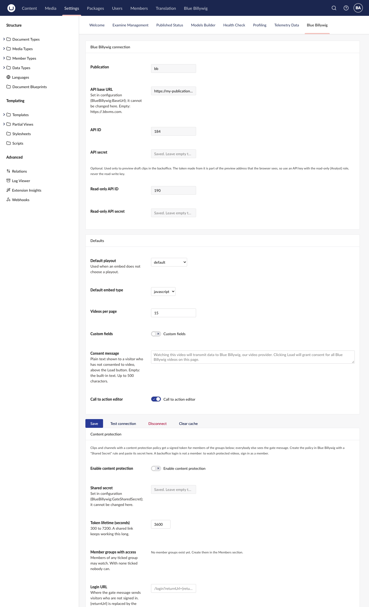

*The Blue Billywig dashboard in Settings. Saved secrets show as "Saved. Leave empty to keep".*

1. Go to **Settings** and open the **Blue Billywig** dashboard.
2. Under **Blue Billywig connection** enter your **Publication** (the first part of `publication.bbvms.com`), **API ID** and **API secret**. The **API base URL** below it is read-only: it is set by your developer in the site's configuration, and normally stays empty (the address is then built from the publication).
3. Click **Save**, then **Test connection**. A message such as "Connected to ..." means it works. "SAPI request failed (401)" means the ID or secret is wrong.

The API secret is never shown again after saving. Leave the field empty to keep the saved one. If a field is greyed out, your developer set it in the site's configuration; ask them to change it. Until credentials are set, the library views show a banner "the package is installed but not configured yet" with a link to the settings.

The other settings: **Default playout** (the player layout used when a video doesn't choose its own), **Default embed type** (`javascript` is the usual choice), **Videos per page**, the **Consent message** (the text above the **Load video** button; empty uses the built-in text, up to 500 characters) and the toggles **Custom fields** (show your publication's custom fields in the editor) and **Call to action editor**. **Disconnect** removes the stored credentials and **Clear cache** empties the package's cache.

## Language

The Blue Billywig screens follow your Umbraco language (**User profile > Language**): English, Danish, German, Finnish, French, Norwegian Bokmål, Dutch or Swedish. A text that is not translated yet, or a language without a translation, shows in English. Not every screen is translated yet; the clip editor, for one, is still English ([TRANSLATIONS.md](TRANSLATIONS.md) has the list). What visitors see on the page (the consent notice, the gate message, the form) follows the language of the page.

## Add a video to a page

The page's document type needs a property that uses the **Blue Billywig Video** editor. If you don't see one, ask your developer.

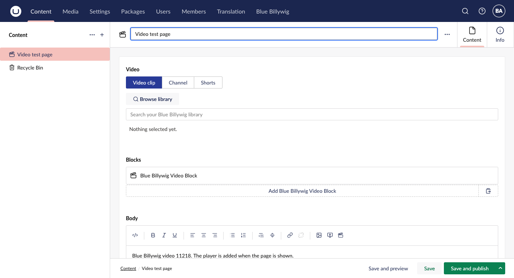

*The Video property on a page: choose Video clip, Channel or Shorts, then browse or search.*

1. Open the page and find the video property.
2. Choose what to show: **Video clip**, **Channel** or **Shorts**.
3. **Video clip:** use **Browse library**, or type part of the title in the search box. Matching clips appear with a picture, a title, the id and the status. Click one to select it. If nothing matches, the list says "No clips found." **Browse library** opens a picker with the same search and filters as the library.

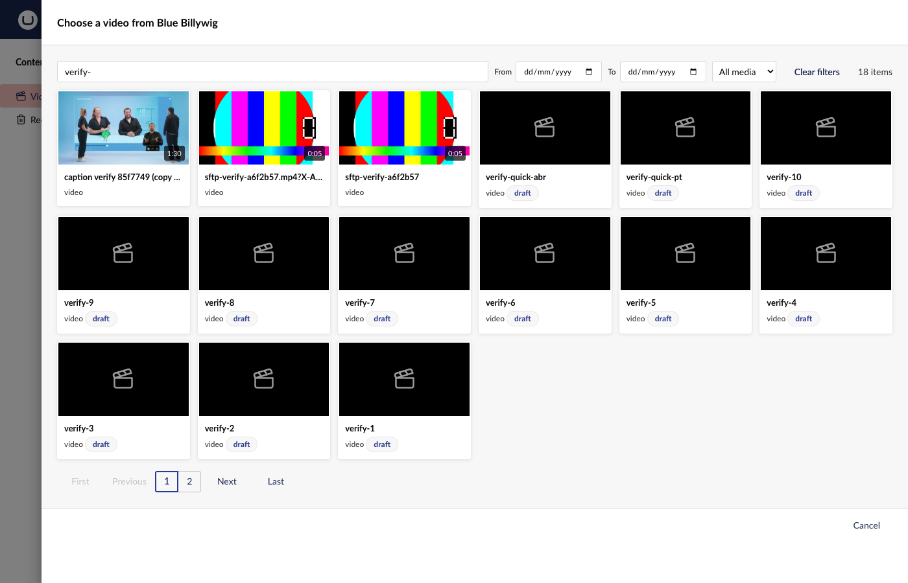

*The library picker opened by Browse library; click a clip to select it.*
4. **Channel** or **Shorts:** choose one from the dropdown. The Channel and Shorts buttons only appear when the publication has any; if that cannot be checked, all three show. In the library picker, the list opens with **Recent videos** (newest first), and a **Live streams** button above the folders shows only the live streams (it appears only when there are some).
5. Set the options (below), then **Save** or **Save and publish** the page as usual.

Under the selection, **Load preview** shows the real player for the chosen clip, channel or Shorts. Nothing loads from the player until you click it. A draft clip plays there when the site owner has set the read-only API pair; otherwise the note under the player says that unpublished clips will not play. Changing the playout or the video hides the player again.

If the chosen clip is a draft, archived or under embargo, a banner above the selection says so and does not play for visitors. **Publish now** (draft or archived) and **Remove embargo** change the clip in Blue Billywig straight away, not when you save the page. They show only for users who may edit clips in the Blue Billywig section.

To use another video, click **Remove** and select again. Switching between Clip, Channel and Shorts clears the selection, because their ids are unrelated.

**Clip options:** **Playout** (the player layout; "Site default" uses the playout chosen for the video in the library, else the setting), **Show transcript** (under the video, collapsible; uses the clip's transcript or else its published subtitles; nothing if it has neither), **Show chapters** (buttons under the video that jump to a time; set the chapters on the clip in the OVP), **Lazy load** (the player loads when it scrolls into view or on click).

**Channel options:** **Height** (for example `600px`; units px, vh, em, rem, %) and **Lazy load** (channels load directly by default).

**Shorts options:** **Height** (for example `700px`) and **Fullscreen** (fills the page width; otherwise at most 400 px wide and centred).

Not every option was seen working in a browser: chapters, lazy load and the per-clip options of the property were not observed, and the shorts player did not load on the development publication (PARITY E1 to E3).

## Paste a video link or use the toolbar button in rich text

In a rich text editor, the **Embed** button accepts a pasted Blue Billywig link such as `https://publication.bbvms.com/p/default/c/123.html`, `.../view/default/123.html` or a channel link `.../ch/123.html`. If your site owner added the **Blue Billywig video** button to the toolbar, it opens the library; pick a video and it is inserted. In the editor you see a short line of text such as "Blue Billywig video 123. The player is added when the page is shown." The player itself appears on the website, made for each visit, so the site's cookie consent applies. It has no transcript or chapters.

## Browse and search the library

Open the **Blue Billywig** section (top bar). Tabs: **Videos**, **Livestreams**, **Playlists**, **Upload**, **Platform**.

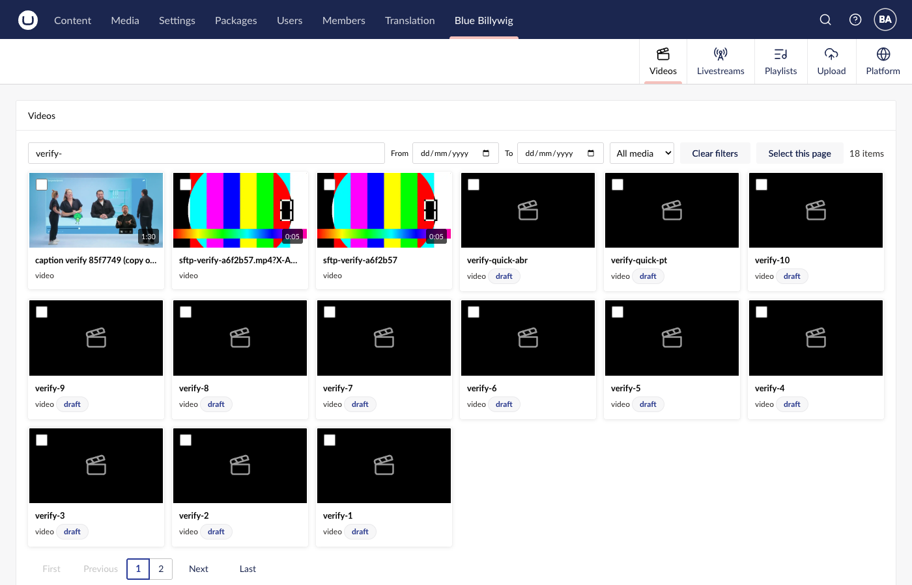

*The Videos tab: search and filters on top, clips as tiles, pages below.*

- **Videos.** A grid of your clips, paginated. Search by title, description or tags; filter by **Published from** and **Published to** and by **Media type** (all, video, audio, image, document); **Clear filters** resets. A **Folders** tree on the side narrows to a folder; it appears only when the publication has folders (checked with stubbed data only: the development publication has none, so it is not in the screenshots). Hover over a picture for a short silent preview, where the clip has one (not on touch screens or with reduced motion).
  - *Search with a hyphenated word:* a single hyphenated word (for example `verify-10`) is sent to Blue Billywig as a quoted phrase, because Blue Billywig otherwise reads it as several separate words and returns most of the library. A search of several words is sent as typed, with special characters escaped.

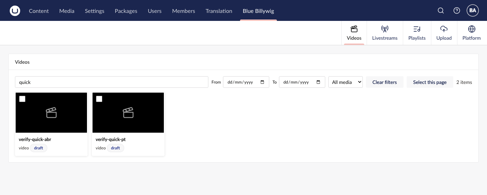

*Searching the library: the grid shows only the clips that match.*

- **Click a video** to open its details: **Load preview** plays it, **Details** shows its data, **Copy embed code** copies the code for the clip. Buttons **Edit**, **Delete** (only if you may) and **Close**.

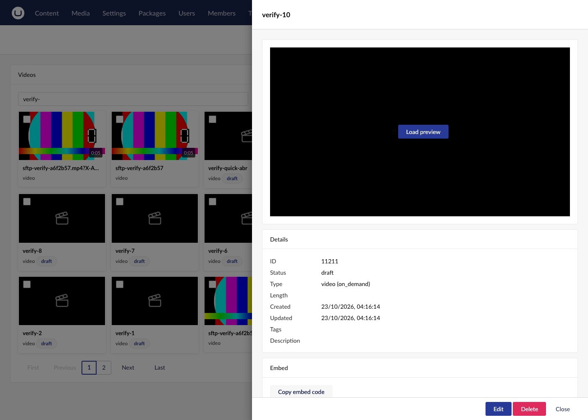

*A clip's details panel: preview, data and embed code.*

- **Livestreams** and **Playlists** list them. A playlist has a **Copy** button for its embed code; search playlists by title.

- **Platform.** Links to your publication in the OVP (library, playouts, channels, analytics) and to documentation and support.

If Blue Billywig cannot be reached, the list shows an error with **Try again**. An error is not the same as "no videos". Note: on the development platform, recently uploaded clips or the date filter sometimes lag behind, because the platform answers from servers that briefly disagree. Wait a minute and reload.

## Upload a video

**Blue Billywig > Upload.**

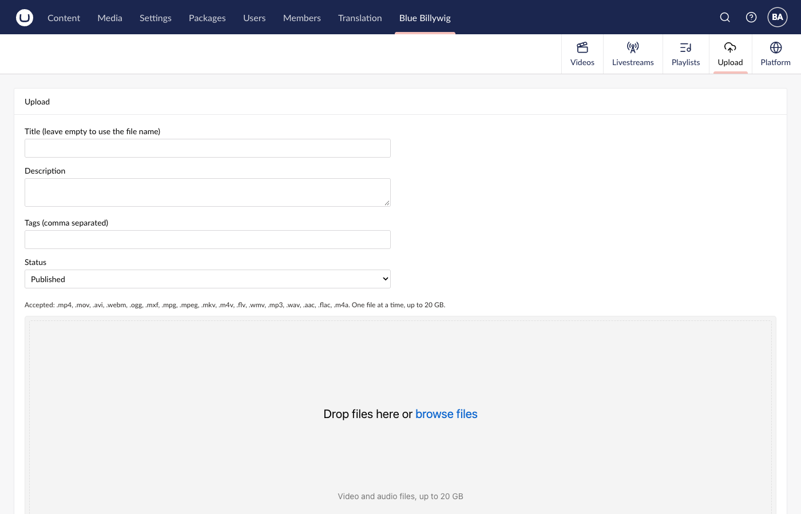

*The Upload tab: details first, then the drop area.*

1. Fill in **Title** (leave empty to use the file name), **Description**, **Tags** (comma separated) and **Status** (Published, Draft or Archived).
2. Drop a file in the box or choose one. Types: mp4, mov, avi, webm, ogg, mxf, mpg, mpeg, mkv, m4v, flv, wmv, mp3, wav, aac, flac, m4a. One file at a time, at most 20 GB.
3. Press **Upload**. The file goes straight from your browser to Blue Billywig's storage; it does not pass through the Umbraco server.

When it is done, the page says "Uploaded ... as clip N. It appears in Videos once processing has finished." Cancelling or a failed upload removes the half-created clip. If it cannot, the message gives the clip number so you can delete it in the OVP.

Limits: a clip uploaded as **Draft** can still be **published by the platform when processing ends**; the package cannot hold the status (the reference plugin behaves the same). If the upload fails with "Unknown error" or a message about storage, the storage may not allow your site's address; ask Blue Billywig support.

## Edit a video

Open a video and press **Edit**. The editor has these parts, top to bottom: Thumbnails, Details, Subtitles, Call to action and Engagement. **Save** at the bottom saves the details; it is enabled when something changed. The thumbnail, subtitle and call to action parts save on their own.

- **Details.** **Title**, **Description**, **Tags** (type and press Enter or comma; click x to remove; suggestions appear as you type), **Status**, **Content protection policy** (None or one of your policies), **Playout** (used for this video's embed code and preview in the library), **Folder**, **Language**, **Embargo from / to (UTC)**. Custom fields appear if the site owner switched them on.
- **Thumbnails.** Upload a JPG or PNG (up to 10 MB; it must have about the shape of the video, within 15 percent) and press **Set as main** on a picture. The player can take up to about two minutes to show a new thumbnail.
- **Subtitles.** Upload a `.vtt` or `.srt` file (up to 1 MB; the file must really look like that format), choose the language, optionally a name, and tick **Publish** and **Make default**. Delete a subtitle with **Delete** (only if you may). **Set default** on an existing subtitle may fail on some publications: Blue Billywig answers "ok" but changes nothing when the default follows the publication's default language, and the editor then shows an error instead of pretending it worked.
- **Call to action** and **Analytics**: below.

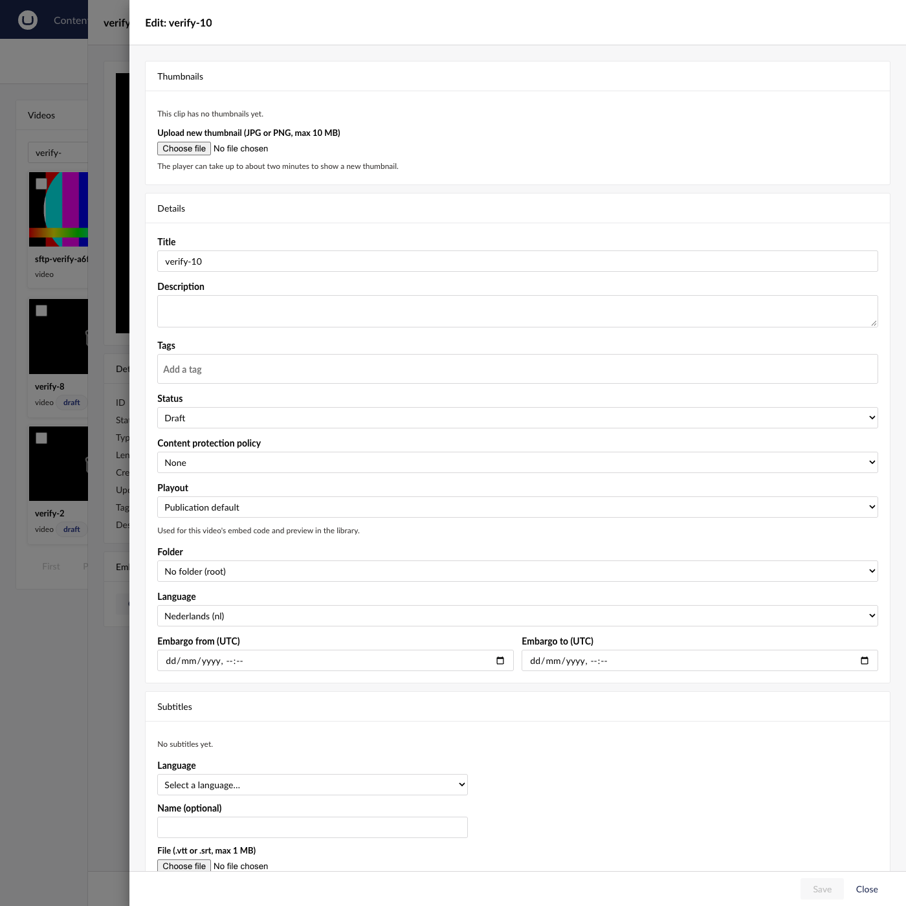

*The clip editor: thumbnails and details at the top, subtitles below.*

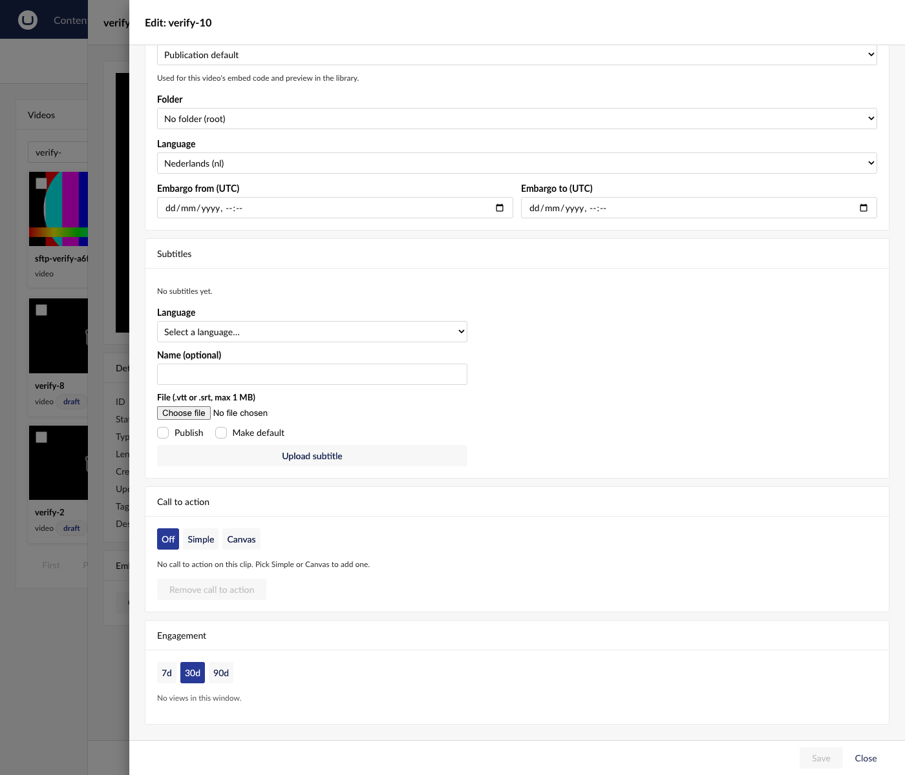

*Further down: subtitles, the call to action mode tabs and the Engagement box.*

Known limits (PARITY M1, M6, M8): the publication date is not saved from here; a language cannot be cleared once set; an **embargo is removed by writing a past marker** (Blue Billywig on the development platform ignores an empty date, so the package writes a value it turns into an old date with no effect; the editor shows the field as empty, and says "Embargo removed." only when the saved clip shows it gone); the folder field was untested on the development publication; typing the embargo dates by hand was not exercised.

## Bulk actions

In **Videos**, tick clips (or **Select this page**). A toolbar appears: choose **Change status**, **Move to folder** or **Set content protection policy**, pick the value and press **Apply**; or **Delete selected** (only if you may); **Clear selection** to start over. At most 50 clips at once. The result tells how many succeeded and lists the ones that failed. In testing, bulk status was checked in the interface; bulk folder and policy were not run there.

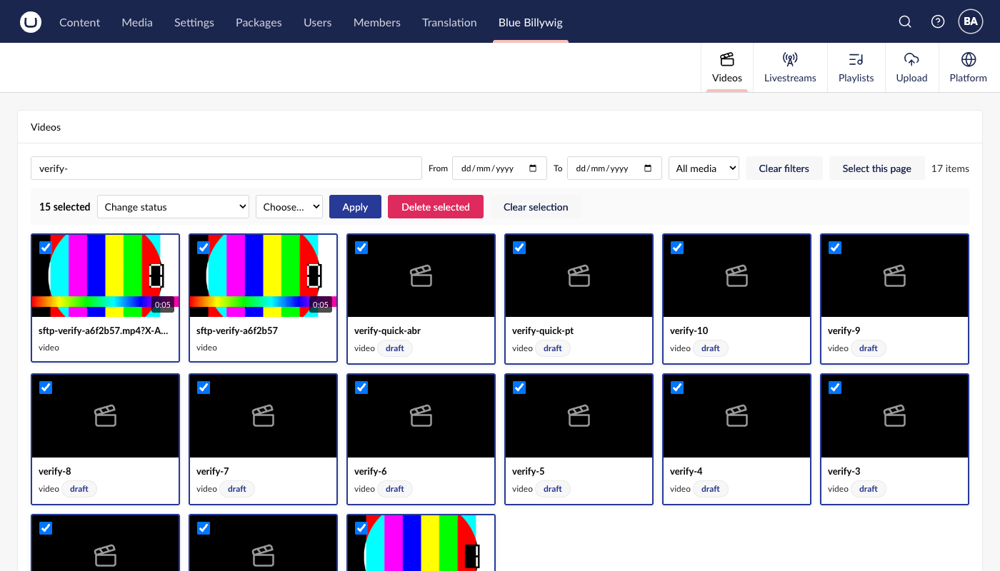

*Clips ticked in the grid: the bulk toolbar appears above it.*

## Call to action

In the editor, the **Call to action** box adds a button or an email form that appears over the video. Modes: **Off** (removes the call to action when you save), **Simple** (pick a position preset) and **Canvas** (drag the box into place).

- **Type:** **Click-through link** (needs a target URL and a button label or an image) or **Email form overlay** (labels for the email field, submit button and thank-you message, and an optional **Submit endpoint**: the address your developer set up to receive the entries; without one the form only remembers the visitor in their browser).
- Headline, body, button label, **Open in new tab**, **Pause video while visible**, **Show from / until** (seconds; "until the end" needs the clip's length), background, border, colours, and an optional image to use instead of a colour (search by name or enter the image ID, or upload one).
- Press **Save call to action**. Mistakes are listed under the form. **Remove call to action** deletes it. You need only the Blue Billywig section for this, not the delete permission.
- If the clip already has a timeline that was made by another tool, the editor locks and tells you; the package will not overwrite it.
- If the **Call to action editor** setting is off, the box is not shown.

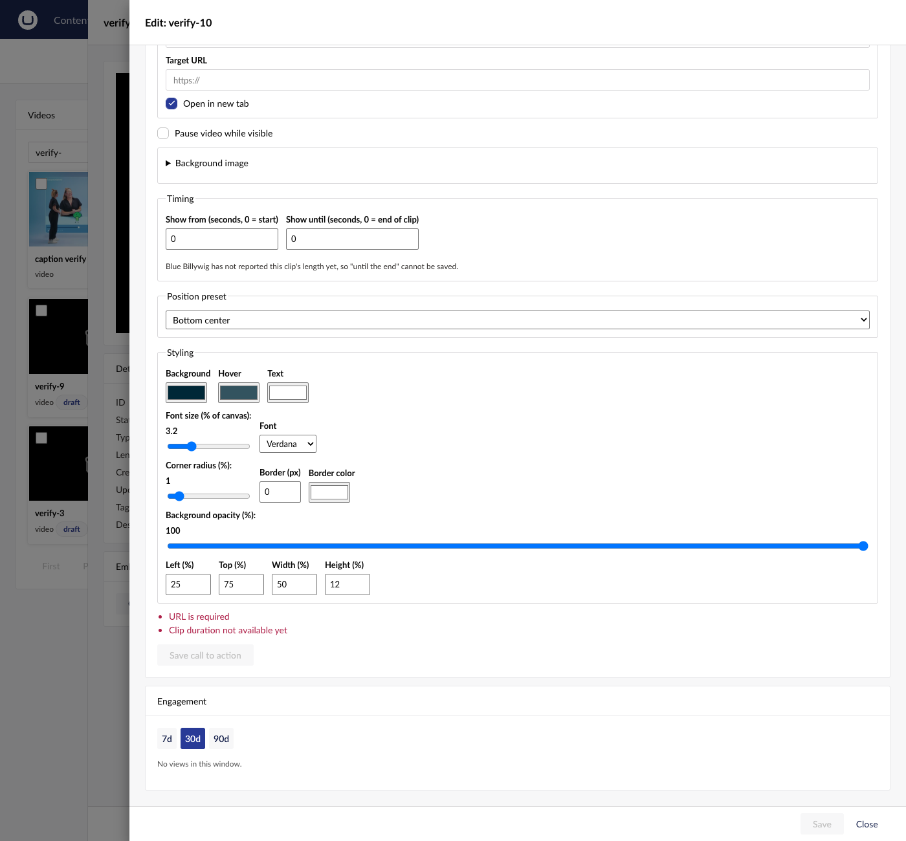

*Simple mode: a position preset, timing and styling. Save stays disabled while the form lists errors.*

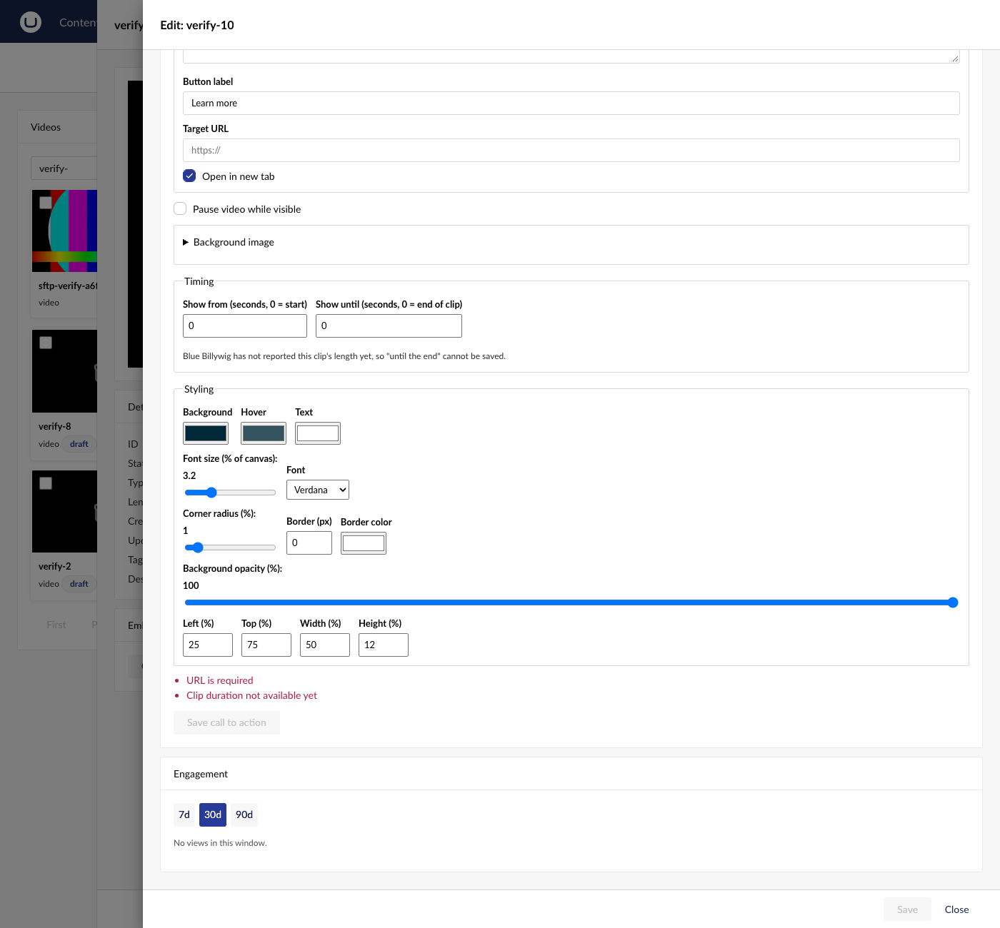

*Canvas mode: button label and target URL, then timing, styling and the position as left, top, width and height in percent.*

Limit: how the call to action looks in the live player was **not seen**. The real player did not load on the development publication, so only the saved data and a stand-in of the page form were checked (PARITY C1, C4, C6).

## Analytics

- **Dashboard.** On the Content section's dashboard page, **Blue Billywig video analytics** shows the last seven days: views, player loads, play rate, the top five videos and a device split. It needs access to the Content section. If Blue Billywig cannot be reached it shows an error with **Try again** (not zeros). Figures are refreshed at most every 5 minutes.

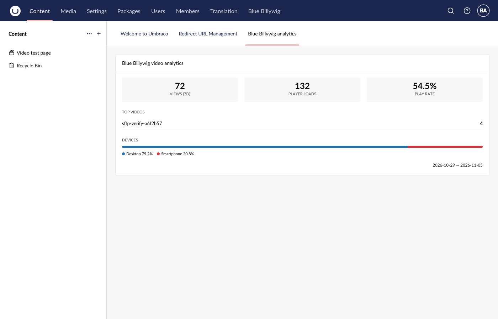

*The analytics dashboard on the Content section's dashboard page (the top videos list is shortened here).*

- **Per video.** In the editor, the **Engagement** box shows views, play rate and average view time for 7, 30 or 90 days, and a retention curve (how much of the video viewers watch). "No views in this window" appears when there are none.

## Protected videos

If your site owner switched on content protection, a video that has a **Content protection policy** plays only for signed-in website members of the allowed groups. Everyone else sees a message, and a login link when one is set. A backoffice login is not a website member. Playback of protected videos has not been proven end to end (PARITY G1); ask your developer to test it on your publication.

## What visitors see

- The video player, or, with lazy load, a picture that turns into the player on scroll or click.
- If the site asks for consent, a short text and a **Load video** button instead of the player. Clicking it allows Blue Billywig videos on that site for the rest of the browser session.
- Visitors without JavaScript get a plain fallback inside the page.

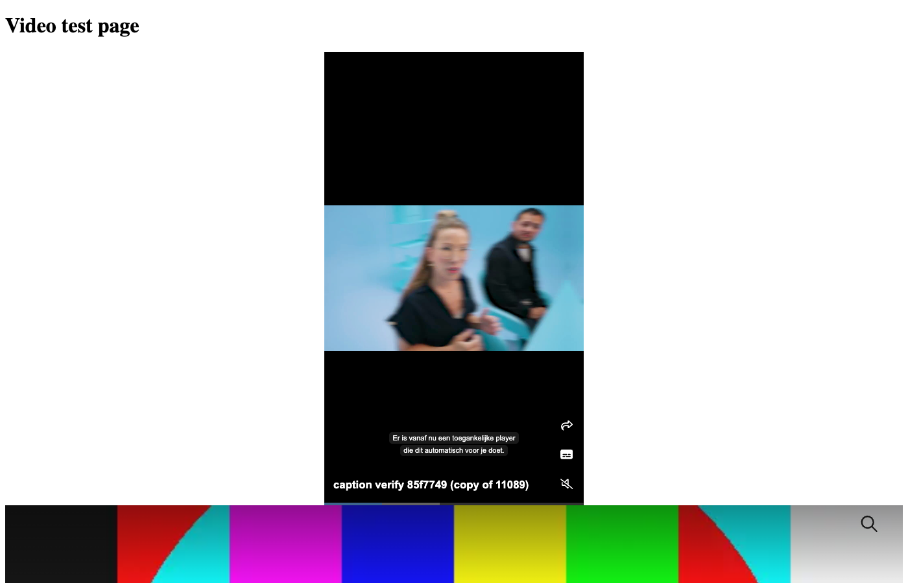

*A page on the demo site with player blocks rendered.*

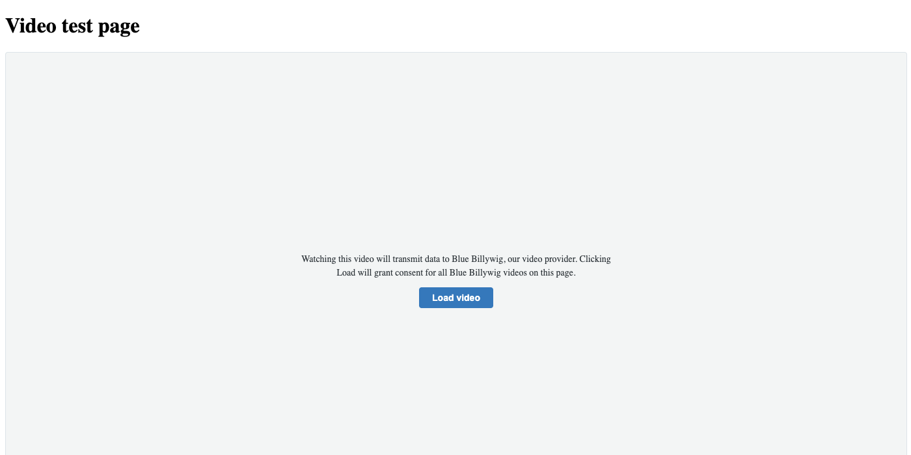

*The consent placeholder a visitor sees before agreeing.*

## If something goes wrong

| What you see | What to do |
|---|---|
| No **Blue Billywig** section in the top bar | Your user group does not have it. Ask the site owner to tick it under Users > User Groups > Sections |
| The Blue Billywig dashboard isn't in Settings | Ask your developer to check the package is installed |
| "Test connection" fails | Check publication, API ID and secret. Ask whoever issued the token |
| The search or library shows an error | Blue Billywig couldn't be reached or the token is wrong. Try again, then use Test connection. An error is not the same as "No clips found." |
| **Delete** is missing or refused | Your group may not delete. Ask the site owner |
| A new thumbnail doesn't show | Wait up to about two minutes |
| **Set default** on a subtitle gives an error | See Edit a video above. The subtitle upload still worked |
| The upload fails with a storage message | Ask Blue Billywig support to allow the site's address |
| The page shows no video | The property is empty or the selection was removed. Select a video again and save |
| You see "Load video" instead of the player | The site is waiting for consent. Click Load video |
| You see a message "This content requires access" | The video is protected. Sign in as a member with access |
| The player is cut off or very small | For a channel or shorts, check the height. Clips scale to the page width |

## Status of everything

Some features above are only partly proven, and a few could not be proven in the test environment. The full list, with the evidence for each, is in [PARITY.md](PARITY.md).
